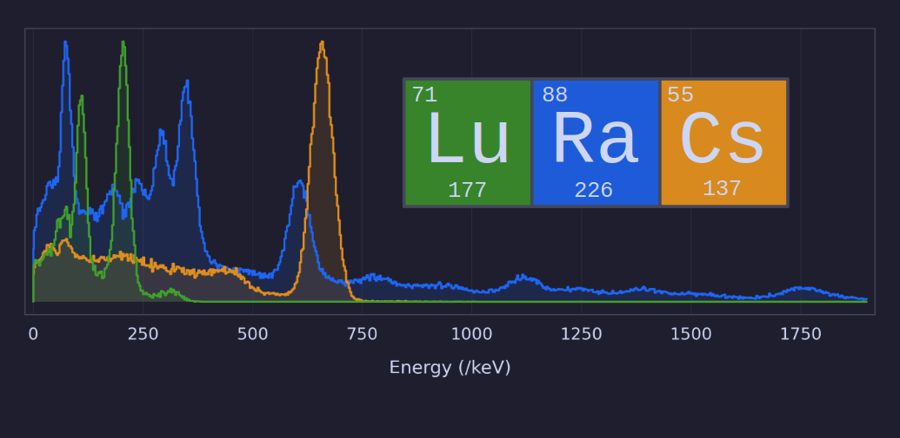
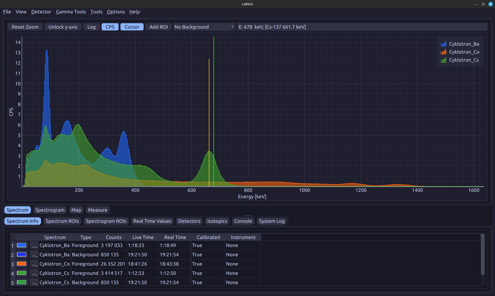
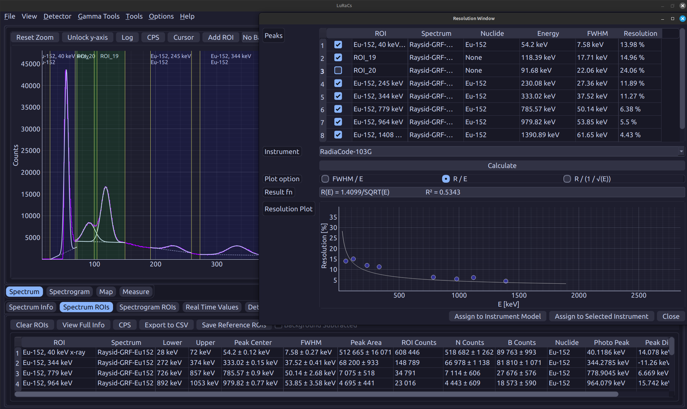
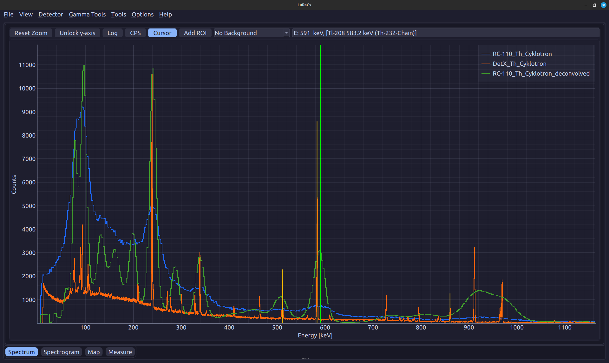
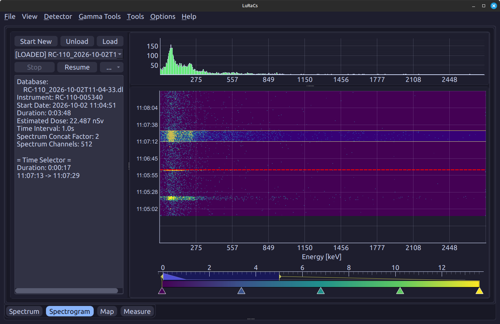
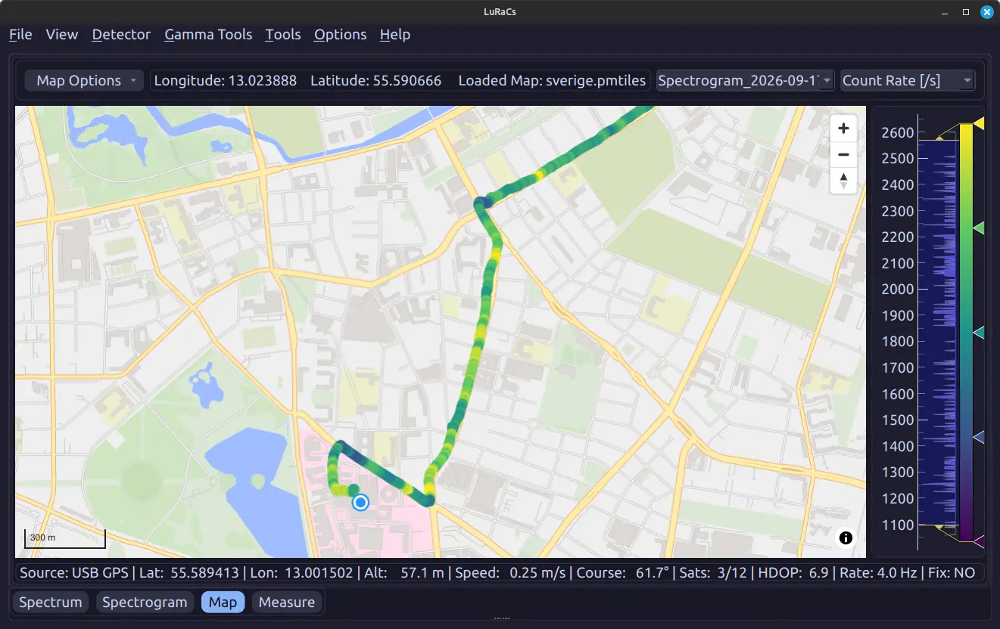
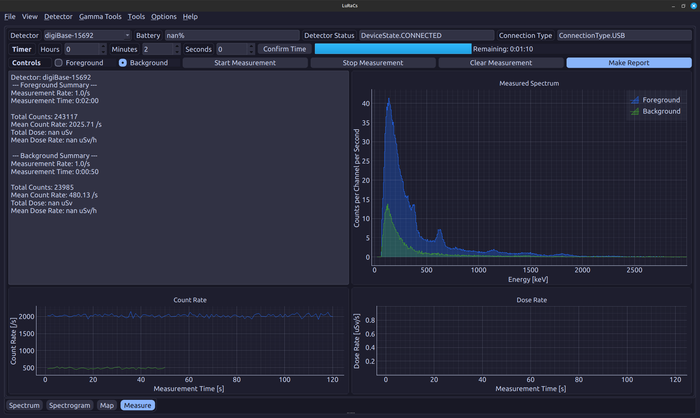
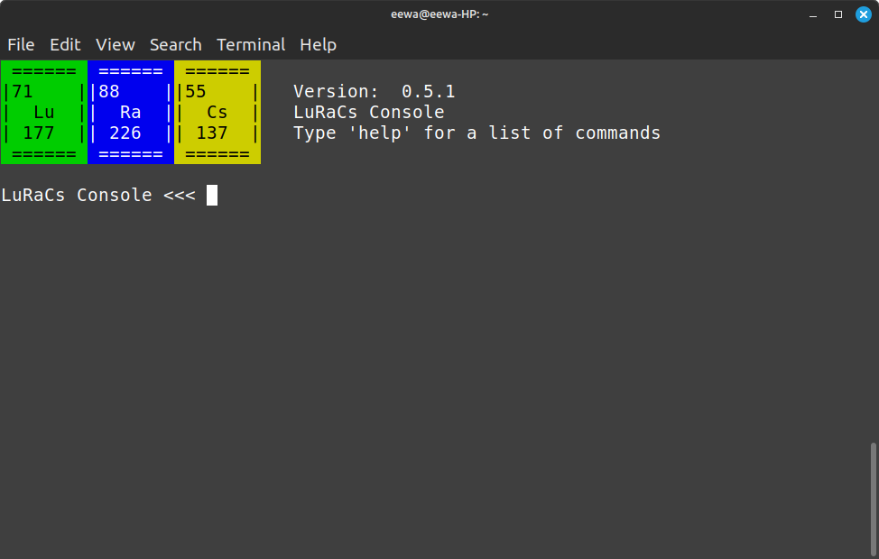
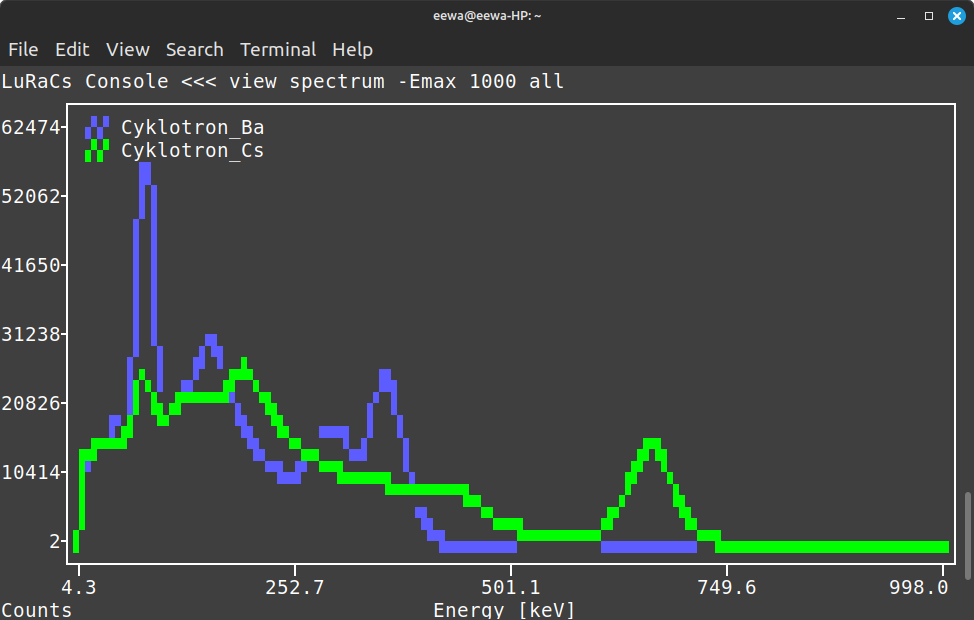
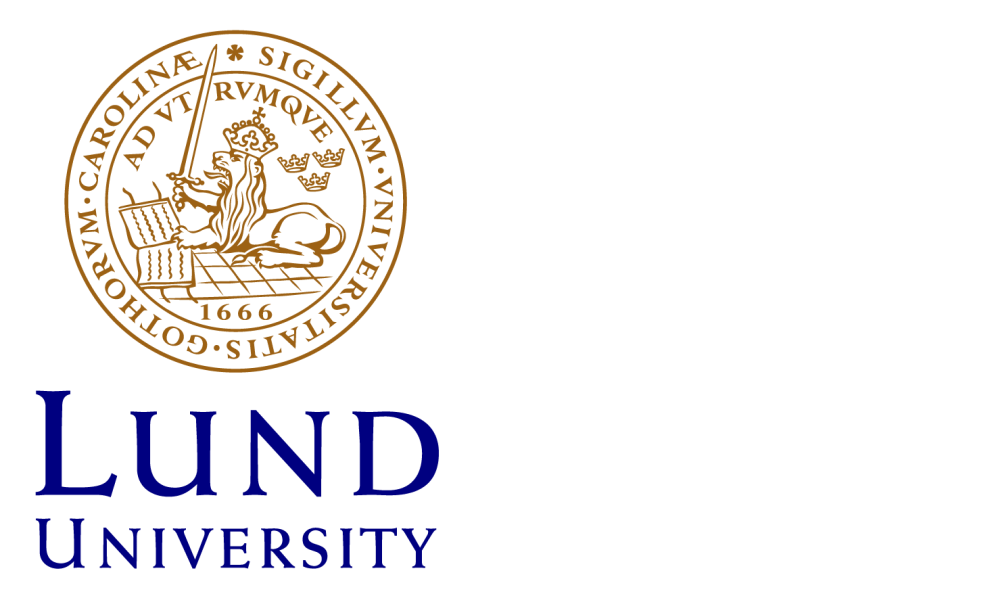

# LuRaCs - *Lund University radiation computing suite*
 [](https://creativecommons.org/licenses/by-sa/4.0/)   


Copyright (c) 2026 Erik Ewald

LuRaCs is a free, open-source application designed for the measurement and analysis of nuclear radiation. While its functionality ranges from basic to advanced radiation analysis, with primary focus is on gamma spectrometry. Built with Qt and primarily written in Python, the software is designed with extensibility in mind, enabling support for a variety of detector systems.

- [LuRaCs - *Lund University radiation computing suite*](#luracs---lund-university-radiation-computing-suite)
  - [Features](#features)
    - [Spectrum View](#spectrum-view)
    - [Analysis Tools](#analysis-tools)
    - [Time Series Measurements](#time-series-measurements)
    - [Area Mapping](#area-mapping)
    - [Timed Measurements](#timed-measurements)
    - [CLI](#cli)
    - [Implemented Detectors](#implemented-detectors)
  - [Installation](#installation)
  - [Documentation](#documentation)
  - [Licence](#licence)
  - [Third-party assets](#third-party-assets)
  - [Acknowledgements \& Affiliation](#acknowledgements--affiliation)

## Features
- Simultaneous measurements with multiple instruments
- Data export to common formats (.n42, .csv, .xlsx)
- ROI selection with peak fitting and automatic updates during measurement
- Calibration and determination of detector characteristics
- Spectrum deconvolution using ML-EM
- Nuclide data with reference emission lines
- Command line interface for remote control and automation
- Time-series and spectrogram-based measurements
- Area mapping using a generic USB-connected GPS device
### Spectrum View
The spectrum view shows a count histogram retrieved from an instrument or loaded from a file. *Regions Of Interest* (ROI) can be defined in which a Gaussian peak can be fitted and the result from the fit used in analysis tools.

### Analysis Tools
LuRaCs provides a comprehensive set of tools for analysing measured spectra. Spectra can be calibrated using known emission lines, and key instrument characteristics such as energy resolution and intrinsic efficiency can be determined, visualized, and stored for future use.

If your primary goal is the analysis of previously acquired spectra, we recommend using [InterSpec](https://sandialabs.github.io/InterSpec/), which offers broader compatibility with a wide range of spectrum file formats and analysis workflows.


LuRaCs also implements a deconvolution tool that can enhance a spectrum using a detector dependent response matrix.       

### Time Series Measurements
When an instrument is connected, measurements can be recorded as a time series in the form of a *spectrogram*. A spectrogram stores the average count rate and dose rate for each acquisition interval, together with the corresponding accumulated spectrum. This enables both temporal trend analysis and detailed examination of the spectral data collected throughout the measurement period.

### Area Mapping
By connecting an external GPS device via USB, area mapping can be performed by extending standard spectrogram measurements with positional data. Maps can be retrieved from an online source via URL or loaded from a locally stored file for offline use. Supports export of mapped data to GeoJSON for use in common GIS applications like QGis.

### Timed Measurements
Spectra and rates can be measured with a timer for standardized protocols with a simple and intuitive  interface. The measurements can the be exported as reports containing both human readable text and computer readable data for importing the report to other spectrum analysis tools.

### CLI
While the graphical user interface provides the primary means of interaction, LuRaCs also supports control via a Command Line Interface. This enables efficient remote operation, for example over an SSH connection to remotely deployed instruments such as a *Raspberry Pi*.

The CLI is started by running with the `--headless` flag.

 


### Implemented Detectors
The following detectors are currently supported through unofficial integrations. These implementations are not affiliated with, endorsed by, or supported by the respective detector manufacturers.

The software authors and integration contributors accept no responsibility for equipment damage, data loss, erroneous measurements, or other issues arising from the use of these integrations. Users are responsible for verifying their correct operation and validating any results obtained.

- [RadiaCode-1xx series & Zero](https://www.radiacode.com/100-series) (USB, BLE)
- [Raysid](https://raysid.com/) (BLE)
- Oretc digiBase (USB)
- Ortec digiDart (USB)
- Ortec Detecive X (NETWORK)
- Flir Identifinder R400 (NETWORK)

## Installation
LuRaCs can be installed from PyPi using the following command.
```shell
pip install luracs
```
Requires Python 3.10, 3.11, 3.12 or 3.13 and a C/C++-compiler.
When installing from source, clone the repository and install using pip:

```shell
git clone --recursive https://github.com/EBELU/LuRaCs.git
cd LuRaCs/

pip install .[dev]
```
## Documentation
LuRaCs documentation can be found [here](luracs/resources/docs/documentation/Welcome.md) or under the *Help*-tab in the open program. 

The full reference manual can be found [here](https://github.com/EBELU/LuRaCs-UserManual)

## Licence
The LuRaCs source code is licensed under the GPL-3.0 license.

The LuRaCs documentation and images are licensed under the CC BY-SA 4.0 license.

## Third-party assets
Copies of third partly licences and notices are packaged in `/licenses`.

## Acknowledgements & Affiliation

LuRaCs is developed and maintained by the Department of Medical Radiation Physics at Lund University, Sweden.

We thank the people who have worked on and contributed to this project.
  - Erik Ewald, M.Sc. - Software Lead 
  - Christian Bernhardsson, Ph.D. - Project Supervisor
  - Malte Axner - Contributor
  - Sigurður Emil Pálsson, Ph.D. - Software Tester


